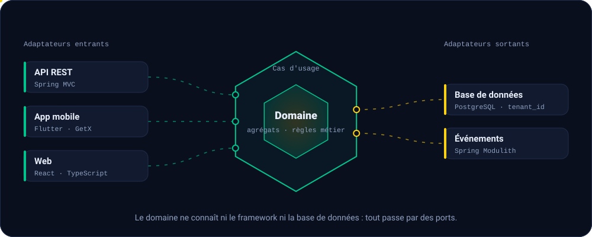

**[LinkedIn](https://www.linkedin.com/in/abdourahamane-diallo-3075b428a)** · Ouvert aux opportunités de développeur Full-Stack junior · Nouveau-Brunswick, Canada

## À propos

Originaire de Guinée, formé au Sénégal, installé au Nouveau-Brunswick. Je conçois des backends **Spring Boot** en architecture hexagonale, des applications mobiles **Flutter** et des interfaces **React + TypeScript**. Je travaille sous la marque **JeeriDev** et je vise le métier d'**architecte logiciel**.

- **Formation** : École du Code Sonatel Academy × Orange Digital Center (Dakar, promotion 7, 2024–2025). Premières lignes de code à l'Université Assane Seck de Ziguinchor.
- **Études** : Techniques multidisciplinaires en systèmes informatiques, CCNB, depuis septembre 2026.
- **J'approfondis** : NestJS (microservices), TDD, patterns d'architecture et d'intégration. Je documente en LaTeX / Beamer.
- **Hors code** : l'architecture du bâtiment. J'explore des concepts de villas modernes adaptées au climat ouest-africain.

## Architecture de référence

C'est le schéma que j'applique sur mes backends : SOLID et DDD dans le domaine, Spring Modulith pour les frontières de modules, multi-tenance PostgreSQL par `tenant_id`, GetX Clean Architecture côté Flutter, Git Flow et CI/CD avec GitHub Actions, SonarCloud et Dokploy.

## Projets

| Projet | Ce que c'est | Stack |
|---|---|---|
| **Mobile Money : plateforme de grossistes et app terrain** | Projet de fin de formation, soutenu : plateforme multi-tenant de gestion de grossistes Mobile Money (paiements récurrents planifiés, import massif Excel/CSV, quotas par tenant). **uv_distrib** : application de gestion d'agents de terrain pour les opérations Mobile Money. | Java · Spring Boot · Spring Modulith · PostgreSQL · Flyway · Flutter · GetX |
| **ASC SONATEL : plateforme numérique** | Plateforme de l'association sportive et culturelle : site principal responsive (membres, sport, escouades, contenu éditorial, boutique, chatbot) et application Next.js séparée, « Leuk & les Petits Sages », pour les activités culturelles des enfants. Conception UML complète (22 cas d'usage, 10 entités), déploiement sur VPS prévu. | Next.js · React · Node.js · PostgreSQL · Dokploy · GitHub Actions |
| **[Sentinelle](https://sentinelle.tinkin.tech/)** | Signalement anonyme du racisme et des discriminations au Nouveau-Brunswick : parcours en 3 étapes pensé mobile d'abord, tableaux de bord pour le personnel. Frontend en ligne, backend NestJS à venir. | React · TypeScript · Vite · Tailwind · shadcn/ui · react-i18next · Vitest |
| **MarketFlow** | Interface SaaS de gestion de supermarché, avec une page de connexion animée en canvas (particules et constellations). Backend NestJS prévu. | React · TypeScript · Vite · Tailwind · shadcn/ui |
| **Gestion de poulailler** | Application mobile de gestion de ferme avicole : modules par rôle (Fermier, Distributeur, Propriétaire), factures PDF, scan de codes QR. | Flutter · GetX |

<!-- Ligne prête pour Site L2I : colle-la dans le tableau ci-dessus, juste avant la ligne de la gestion de poulailler, après avoir remplacé les trois champs.
| **Site L2I** | DESCRIPTION EN 1 À 2 PHRASES (ce que fait le site, pour qui, ton rôle) | STACK |
-->

## Activité

<picture>
  <source media="(prefers-color-scheme: dark)" srcset="snake-dark.svg" />
  <source media="(prefers-color-scheme: light)" srcset="snake.svg" />
  
</picture>

English summary

**Full-stack web & mobile developer** from Guinea, trained in Senegal, now studying and living in New Brunswick, Canada. I build backends with **Spring Boot** (hexagonal architecture, DDD, modular monolith), mobile apps with **Flutter**, and web apps with **React + TypeScript**. Goal: become a **software architect**. Open to junior full-stack opportunities. My English is a work in progress, and I'm actively improving it.

